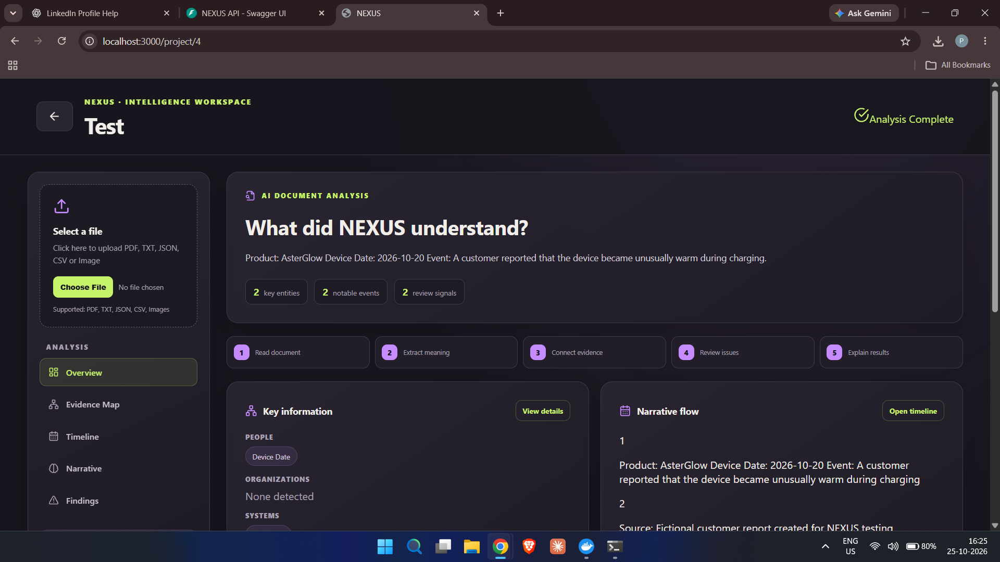
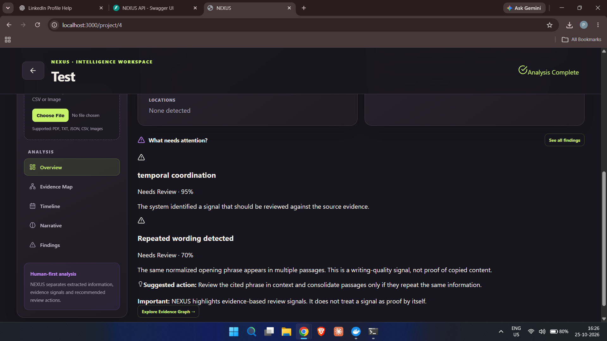
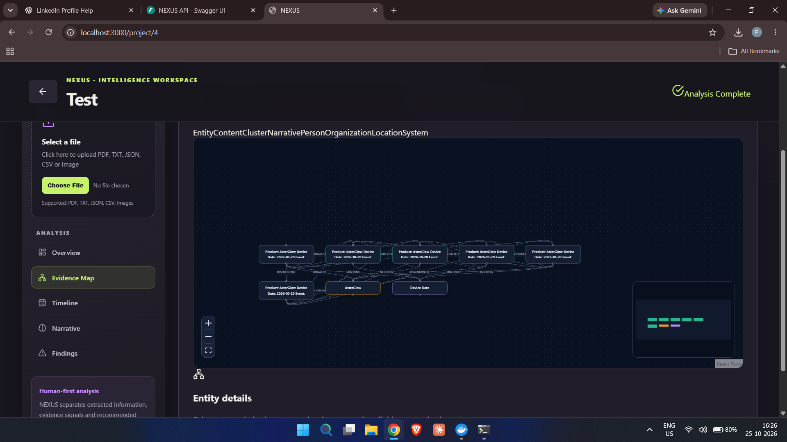
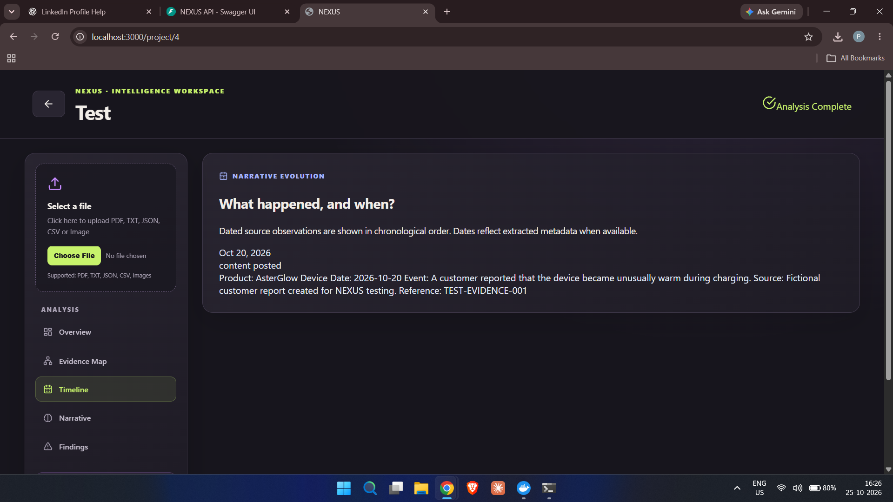

# NEXUS — Narrative Evolution & Evidence Intelligence System

**An AI-powered evidence intelligence platform for analyzing fragmented information, tracing narrative evolution, connecting evidence, and identifying patterns with transparent, evidence-aware review.**

[](https://www.python.org/)
[](https://fastapi.tiangolo.com/)
[](https://react.dev/)
[](https://www.docker.com/)
[](LICENSE)

---

## 📌 Overview

NEXUS (Narrative Evolution & Evidence Intelligence System) is a forensic analysis platform designed to examine how fragmented pieces of digital information evolve, connect, and form patterns over time.

It combines narrative analysis, temporal evidence tracking, entity relationships, and evidence-aware review to help users understand findings and inspect the source information behind them.

NEXUS is designed to avoid presenting uncertain conclusions as established facts. When evidence is insufficient, findings should be reviewed rather than treated as verified conclusions.

## 🎯 Core Question

> How do fragmented pieces of information evolve, connect, mutate, and form measurable patterns over time — and can an AI system explain its findings using the underlying evidence?

## ✨ Key Features

### 1. Narrative DNA
Represent the core elements of a narrative in a structured form to support comparison and analysis.

### 2. Narrative Evolution
Organize dated observations chronologically and examine how narratives change over time.

### 3. Evidence Graph
Explore relationships between entities, events, and source evidence through an interactive graph.

### 4. Evidence-Aware Verification
Review claims against available evidence and distinguish supported information from claims that need further verification.

### 5. Coordination Signals
Highlight potential temporal or relationship patterns for human review. A detected pattern is a signal to investigate, not proof of coordination.

### 6. Human-First Analysis
Present the main narrative, key information, timeline events, review signals, source evidence, and suggested review actions in an accessible Overview.

### 7. Source-Content Review
Flag potential issues such as:
- Conflicting measurements
- Inconsistent dates
- Conflicting explanations
- Unsupported strong claims
- Repeated wording

These signals support review and do not establish that content is false, copied, or AI-generated.

---

## 📸 Application Screenshots

### Overview Dashboard
The main workspace summarizes the extracted information, key entities, narrative flow, and review signals.



### Evidence Review & Findings
Review potential issues against source evidence before drawing conclusions.



### Evidence Graph
Explore connections between extracted entities, events, and evidence.



### Narrative Timeline
Inspect dated source observations in chronological order.



---

## 🏗️ System Architecture

```text
Multimodal Input
       |
       v
Document Ingestion & Entity Extraction
       |
       v
Temporal Evidence Graph
       |
       +-------------------+--------------------+
       |                   |                    |
       v                   v                    v
  Narrative DNA      Network Signals      Cross-Modal Links
       |                   |                    |
       v                   v                    v
 Mutation Analysis   Coordination Review   Evidence Connections
       |                   |                    |
       +-------------------+--------------------+
                           |
                           v
                 AI Hypothesis Generation
                           |
                           v
                  Claim Verification
                           |
                 +---------+----------+
                 |                    |
                 v                    v
          Evidence Supported    Insufficient Evidence
                 |                    |
                 v                    v
          Evidence-Linked       Review / Abstain
             Findings
                 |
                 v
       Interactive React Dashboard
```

*This diagram describes the intended analysis flow; individual capabilities depend on the available source data and configured services.*

## 🛠️ Technology Stack

| Component | Technology |
|---|---|
| Backend API | Python, FastAPI |
| Frontend | React, React Flow, Recharts |
| Graph Database | Neo4j |
| Relational Database | PostgreSQL |
| Vector Database | Qdrant |
| Background / Caching Service | Redis |
| AI Integration | OpenAI API, where configured |
| Application Infrastructure | Docker Compose |

The repository's configuration files define the exact service setup. Check those files when changing versions or environment settings.

---

## 🚀 Quick Start

### Prerequisites

- Windows 10/11
- Docker Desktop installed and running
- Git, if cloning the repository
- An OpenAI API key and available API quota for API-dependent features

### Option A — One-Click Windows Run

1. Clone or download this repository.
2. Open the project folder.
3. Copy `.env.example` to `.env`.
4. If using OpenAI features, add your API key to `.env` and configure the supported environment variables.
5. Start Docker Desktop and wait until it is ready.
6. Double-click `RUN_NEXUS.bat`.
7. Wait for the services to start, then open the application.

### Option B — Manual Setup

Create your local environment file:

```powershell
Copy-Item .env.example .env
```

Edit `.env` using a text editor. Add valid credentials only where required.

Start the services:

```powershell
docker compose up -d --build
```

Check service status:

```powershell
docker compose ps
```

### Access NEXUS

| Service | URL |
|---|---|
| Frontend Dashboard | [http://localhost:3000](http://localhost:3000) |
| FastAPI Swagger UI | [http://localhost:8000/docs](http://localhost:8000/docs) |
| Backend Health Check | [http://localhost:8000/health](http://localhost:8000/health) |
| Neo4j Browser | [http://localhost:7474](http://localhost:7474) |

Use the Neo4j credentials configured in your local environment. Do not assume default credentials if your configuration differs.

### Generate Synthetic Demo Data

```powershell
cd synthetic_data
python generate_scenario.py
```

Run this command using an environment with the required Python dependencies installed. Follow any additional instructions in the project documentation.

### Stop the Services

If the project includes `STOP_NEXUS.bat`, use it to stop the stack. Alternatively, from the project root run:

```powershell
docker compose down
```

This stops the containers without deleting named volumes. To delete stored data, a separate destructive cleanup may be required.

---

## 🧪 Synthetic Demo Scenarios

The project includes non-political synthetic scenarios for demonstration and testing:

1. **Product Misinformation** — Rumors about a fictional product safety issue.
2. **Security Rumor** — Evolution of a fictional cybersecurity incident narrative.
3. **Corporate Crisis** — A fictional coordinated narrative attack against a company.

These are synthetic examples, not real-world investigations or validated evidence of actual events.

## 📊 Evaluation

NEXUS is designed to be evaluated using measures such as:

- **Narrative Mutation Accuracy:** How accurately meaningful narrative changes are identified.
- **Evidence Precision:** Whether cited evidence supports the associated claims.
- **Abstention Appropriateness:** Whether the system avoids conclusions when evidence is insufficient.
- **False Attribution Rate:** Whether the system incorrectly attributes actions or coordination.

These are evaluation dimensions, not claimed benchmark results. Quantitative performance should be reported only after running documented tests on a defined dataset.

## 📚 Documentation

- [`docs/ARCHITECTURE.md`](docs/ARCHITECTURE.md) — System architecture
- [`docs/API.md`](docs/API.md) — API documentation
- [`docs/EVALUATION.md`](docs/EVALUATION.md) — Evaluation methodology
- [`FINAL_RUN_GUIDE.md`](FINAL_RUN_GUIDE.md) — Project run guide

## 🎓 Academic & Engineering Relevance

NEXUS demonstrates the integration of:

- AI-assisted information analysis
- Knowledge graphs and entity relationships
- Temporal narrative analysis
- API-driven backend development
- Interactive frontend visualization
- Evidence-aware verification and responsible AI principles
- Containerized multi-service application deployment

## ⚖️ Responsible AI & Ethical Design

NEXUS is intended to support human analysis, not replace human judgment.

- It distinguishes potential signals from confirmed findings.
- It avoids treating temporal correlation as proof of causation.
- It does not treat repeated wording as proof of plagiarism or AI generation.
- It should not attribute actions to specific actors without sufficient evidence.
- It should communicate uncertainty and allow review when evidence is insufficient.

Outputs depend on input quality, extraction behavior, service configuration, and the available evidence. Findings should be independently checked before being used for consequential decisions.

## 🔐 Security Notes

- Never commit `.env`, API keys, passwords, or private credentials.
- Keep `.env.example` limited to placeholder values.
- Rotate any API key that may have been exposed.
- Configure database credentials securely before deploying beyond local development.
- Do not expose development services publicly without appropriate authentication and network security.

## 📄 License

This project is intended to be distributed under the MIT License. See the [`LICENSE`](LICENSE) file if included in the repository.

---

**NEXUS — Connect the evidence. Trace the narrative. Review the conclusion.**
